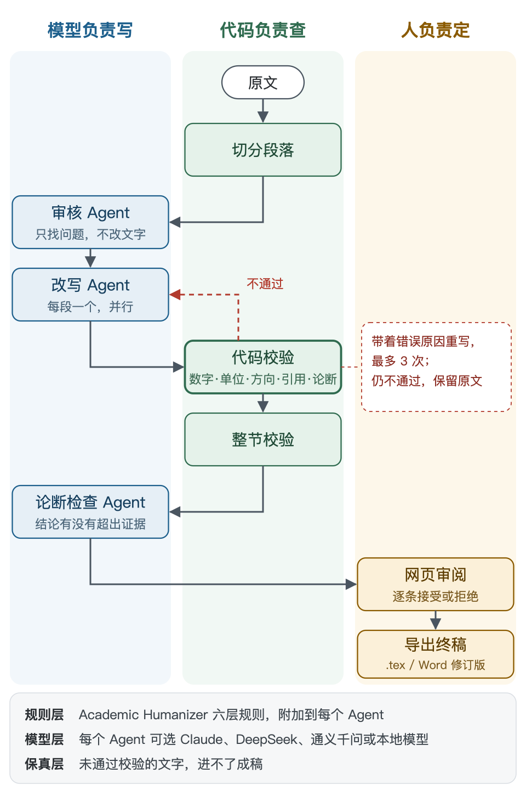
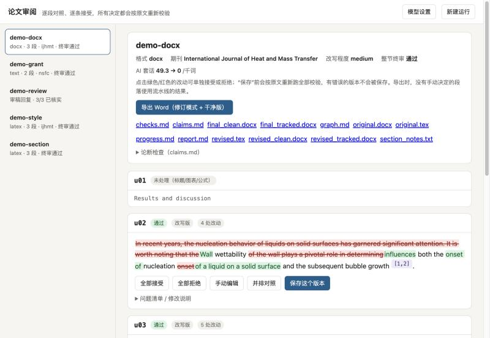
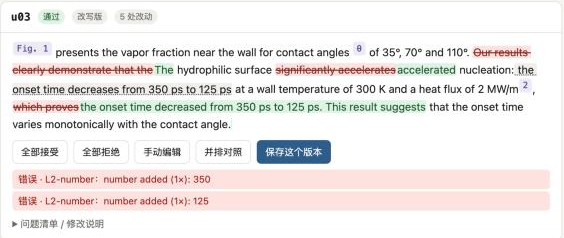
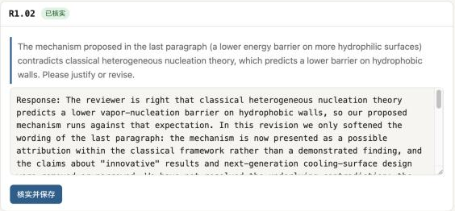
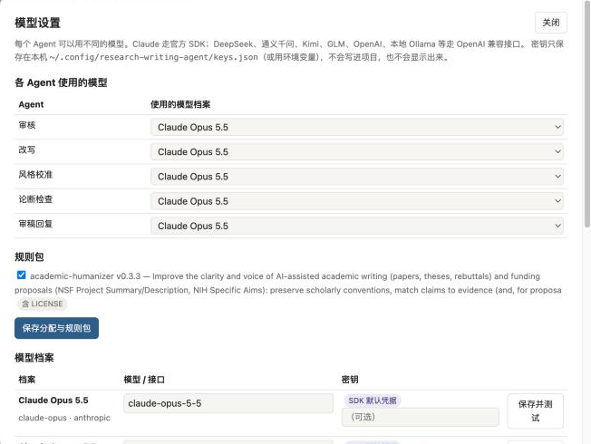
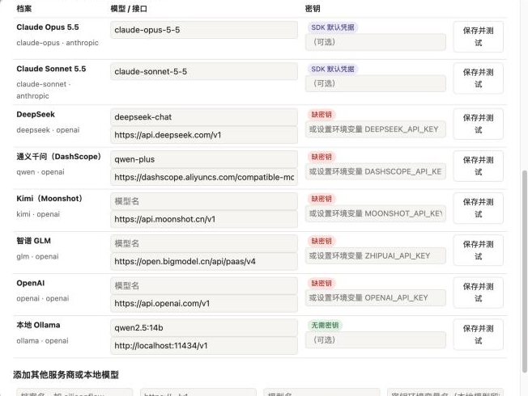

# 让 AI 改论文，但一个数字都不许改错：基于 Academic Humanizer 搭建本地科研写作 Agent

把论文交给 AI 润色，读起来确实更顺了。可你核对过每一个数字吗？

我们做过一个测试：先让 AI 忠实地改写一段沸腾传热的结果，再往改写稿里埋错。350 ps 改成 530 ps，ps 换成 ns，删掉一篇引用，suggest 换成 prove，“小于 1.5 K”改成“1.5 K”。这些错误藏在流畅的句子里，通读一遍很难发现。

这篇文章记录我们如何基于开源项目 Academic Humanizer，搭建一个改写时不许改错的科研写作 Agent。它在本地运行，有网页审阅界面，可以接入 Claude、DeepSeek、通义千问，也可以接入本地的 Ollama 模型。文中的命令都可以直接复制使用。

## 一、Academic Humanizer 是什么

Academic Humanizer 是 AIScientists-Dev 在 GitHub 上开源的一个 Agent Skill，采用 MIT 许可，截至 2026 年 11 月约有 3.7k star。它的核心是一个规则文件 SKILL.md。Claude Code、Codex、OpenCode 等 Agent 读取这个文件后，改写学术文本时就会遵循其中的规范。

规则分为六层：

| 层 | 内容 | 例子 |
|---|---|---|
| 第 1 层 | 通用 AI 腔 | delve、underscore、tapestry；“不仅……而且……”式排比；破折号 |
| 第 2 层 | 学术写作中的 AI 痕迹 | prove、demonstrate 等过强动词；paves the way 之类的拔高；In recent years 式开头 |
| 第 3 层 | 必须保留的学术规范 | 有证据支撑的限定语、必要的被动语态、“we”、公式和符号 |
| 第 4 层 | 论断与证据匹配 | 没有证据的论断，要么补上出处，要么降低语气 |
| 第 5 层 | 作者文风与期刊 | 参考作者以前的论文，贴近其句子节奏和用词 |
| 第 6 层 | 基金申请书 | NSF 和 NIH 申请书的结构；雄心要与可行性匹配 |

第 4 层是它和普通“去 AI 味”工具的区别：每个论断都要对应证据，动词的强度不能超过证据的强度。

它的局限在于它只是一个提示词文件。规则最后要求模型“确认没有改动任何数字、公式或引用”，这只是模型的自我声明，没有程序去核实。另一个同名项目 junbolian/Academic-Humanizer 补上了这一环：它提供检查脚本 check_revision.py，比对改写前后的数字、引用和公式。

我们的做法是把两者结合起来：前者的规则作为“知识层”，后者的检查思路扩展成完整的“保真层”，再加上多 Agent 编排、Word 支持和网页界面。

## 二、整体架构：模型负责写，代码负责查，人负责定

系统分为三层：

- **规则层**：Academic Humanizer 的 SKILL.md 原样收录，附加到每个 Agent 的说明里，许可证和来源说明一并保留。
- **模型层**：Claude 走官方 SDK；DeepSeek、通义千问、Kimi、GLM 和本地模型走 OpenAI 兼容接口。每个 Agent 可以用不同的模型。
- **保真层**：所有改写都要经过代码校验。不通过就带着错误原因重写，最多 3 次；仍不通过，就保留原文。

一段文字的处理流程如图 1 所示。



*图 1　处理流程：模型负责写，代码负责查，人负责定。改写没有通过校验时，会带着错误原因退回重写，最多 3 次。*

代码校验覆盖这些内容：

- **公式、引用、交叉引用、Word 里的 Zotero 引用域**：替换成占位符，模型看不到原文，也就改不了。
- **数字和单位**：数值、单位以及数字对应的对象都不能变。
- **增减方向**：“从 350 ps 降到 125 ps”不能变成“从 125 ps 降到 350 ps”。
- **数值界限**：“小于 1.5 K”不能变成“1.5 K”。
- **论断强度**：suggest < indicate < show < demonstrate < prove，只能降不能升。
- **引用**：只能使用 .bib 里存在的文献。
- **中文**：同样检查“从……到……”、“小于”、“约”、“可能”，以及“证明 > 验证 > 表明 > 说明 > 提示”这一强度阶梯。

为了验证校验是否有效，我们用 10 段热科学文字建了一个埋错基准集，在改写稿中埋入 15 类错误。结果如下：

- 必须拦截的 7 类错误全部被拦截；
- 需要提醒的 7 类错误全部给出提醒；
- 对忠实改写的误拦为 0。

已知的盲区只有一个：同一句里两个同单位的数字互换了对象。这一项交给论断检查 Agent 判断。

实际运行中还发现了一个物理问题。演示段落里有一句“亲水表面的成核能垒更低”，而经典成核理论的预测恰好相反。审核 Agent 和论断检查 Agent 都指出了这一点。改写 Agent 只加了限定语，没有替作者编造解释，问题最终留给作者判断。

## 三、本地部署

环境要求：

- **系统**：macOS 或 Linux（Windows 请使用 WSL）。
- **Python**：3.11 及以上。
- **依赖**：校验引擎和网页应用只用 Python 标准库；只有调用 Claude 时，才需要安装 anthropic SDK。

**第 1 步，获取代码，建立虚拟环境：**

```bash
git clone <项目仓库地址> research-writing-agent
cd research-writing-agent
python3 -m venv .venv
.venv/bin/pip install anthropic
```

之所以用虚拟环境，是因为 Homebrew 安装的 Python 会拒绝直接执行 pip install，并提示 externally-managed-environment。

**第 2 步，配置密钥。** 在你自己的终端里执行：

```bash
echo 'export ANTHROPIC_API_KEY=sk-ant-...' >> ~/.zshrc
source ~/.zshrc
```

**第 3 步，确认环境正常：**

```bash
.venv/bin/python -m unittest discover -s tests -t .
.venv/bin/python -c "from checker import llm; print(llm.test_profile('claude-opus'))"
```

第一条命令最后应显示 OK，表示全部测试通过；第二条应显示 'ok': True。

**第 4 步，跑一个示例：**

```bash
.venv/bin/python -m checker run examples/section.tex --style ijhmt --level medium
```

结果写在 runs/ 目录下：report.md 是修改报告，revised.tex 是改后的文稿，checks.md 记录了每一次校验。

处理自己的文件时，只需修改路径，支持 .tex、.docx 和 .txt。中文基金申请书加上 --style nsfc。

如果你用 Claude Code，还有一种更直接的方式：在项目目录里打开 Claude Code，输入 /academic-writing 润色 paper/results.tex。

## 四、网页版：逐条接受，每一步都重新校验

网页审阅应用不需要另外安装，一条命令启动：

```bash
.venv/bin/python -m checker app
```

浏览器会自动打开 http://127.0.0.1:8765。应用只监听本机地址，你的论文不会离开这台电脑；唯一的例外是调用模型时，文本会发送给你选择的模型服务商。



*图 2　审阅应用。左侧是历次运行，右侧逐段显示改动：红色是删除，绿色是新增；[1,2]、Fig. 1、θ 这些标签是锁定的引用、交叉引用和斜体符号。*

它的实现很简单：后端是 Python 标准库的 http.server，前端是一个不依赖任何框架的 HTML 文件。整个界面由 Claude Code 生成，经过自动化测试，也在浏览器里实际操作验证过。

主要功能：

1. **逐段对照**：每段显示原文与改写的逐词差异，删除标红，新增标绿。公式、引用、斜体符号显示成锁定的标签。
2. **逐条接受或拒绝**：点一下改动即可切换。
3. **实时校验**：每做一次选择，都会对照原文重新跑全部校验。我们实测过这样一种情况：改写把一句话挪了位置。如果只拒绝“删除旧句”，同时接受“插入新句”，数字 350 和 125 就会出现两次。页面会立刻提示“number added”，并拒绝保存。
4. **导出**：LaTeX 导出 final.tex。Word 导出两份：修订模式版本和干净版。修订模式文件在 Word 里打开，就能逐条接受或拒绝；原有的 Zotero 引用域、公式和表格都保持原样。
5. **审稿回复**：每条回复里引用的原文，必须能在修改稿中逐字找到。只要声称“已修改”，就至少要有一处引用是修改稿里新出现的文字；实际没改，就必须写“Change: none”。

图 3 是第 3 项“实时校验”的实际效果：



*图 3　只拒绝“删除旧句”、保留新句后，350 和 125 各出现了两次。页面立即提示 number added，并拒绝保存。*

图 4 是第 5 项“审稿回复”的一个例子：



*图 4　审稿人质疑能垒机理与经典成核理论相反。回复承认这一点，并说明本次只改了措辞，问题留给作者决定。回复中引用的原文都能在修改稿里逐字找到，所以标为“已核实”。*

我们用三类文档各跑了一遍：Word 论文、中文国家自然科学基金申请书和审稿回复。以中文申请书为例，“近年来”“具有重要意义”这类套话从每千字 31.4 处降到 0，“证明”降为“表明”，“首次”“填补空白”“国际领先”被删除。所有数字都没变，“从 35 kPa 降低到 9 kPa”的方向也保持不变。

## 五、接入其他模型

模型配置集中在 config/models.toml，每个模型是一个“档案”：

```toml
[profiles.deepseek]
type = "openai"
base_url = "https://api.deepseek.com/v1"
model = "deepseek-chat"
key_env = "DEEPSEEK_API_KEY"
```

内置档案包括 Claude Opus、Claude Sonnet、DeepSeek、通义千问（DashScope）、Kimi、智谱 GLM、OpenAI 和本地 Ollama。Kimi、GLM 和 OpenAI 的模型名需要按服务商文档自行填写。其他服务商的模型名也更新得快，使用前请先核对。

**用法一：命令行指定模型。**

```bash
export DEEPSEEK_API_KEY=sk-...
.venv/bin/python -m checker run paper.docx --style ijhmt --profile deepseek
```

**用法二：在网页里按 Agent 分配。** 点右上角“模型设置”，可以给审核、改写、风格校准、论断检查和审稿回复分别选择模型。一种常见的搭配是：审核和论断检查用较强的模型，改写用较便宜的模型。每个档案都有“保存并测试”按钮，会发一个很小的请求，返回耗时或错误原因。



*图 5　模型设置：为每个 Agent 选择模型，并勾选要附加的规则包。*



*图 6　内置的模型档案。缺少密钥的档案标为红色；本地 Ollama 不需要密钥。*

**用法三：本地模型。** 安装 Ollama 后执行：

```bash
ollama pull qwen2.5:14b
ollama serve
```

然后在网页里测试“本地 Ollama”档案。LM Studio 的用法相同，只需把地址改为 http://localhost:1234/v1。

较小的本地模型更容易写错数字或漏掉占位符，因此会更频繁地被校验退回。这是预期行为：校验对所有模型一视同仁，没有通过的文字进不了成稿。

## 六、使用前请注意

- **不要用它规避 AI 检测**：这个工具的目的不是降低 AI 检测率。Academic Humanizer 的作者和我们都反对这种用法；用了 AI 辅助写作，请按期刊要求如实披露。
- **指标偏乐观**：基准集和规则都是我们自己写的，所以指标会偏好看。更可靠的做法是把你自己论文里的段落加进基准集。
- **核对期刊配置**：配置中标注 verify 的字段，请以最新的投稿指南为准。

AI 可以把论文写得更清楚。数字、引用和结论的强度，则交给程序和你本人把关。

项目地址：<项目仓库地址>
